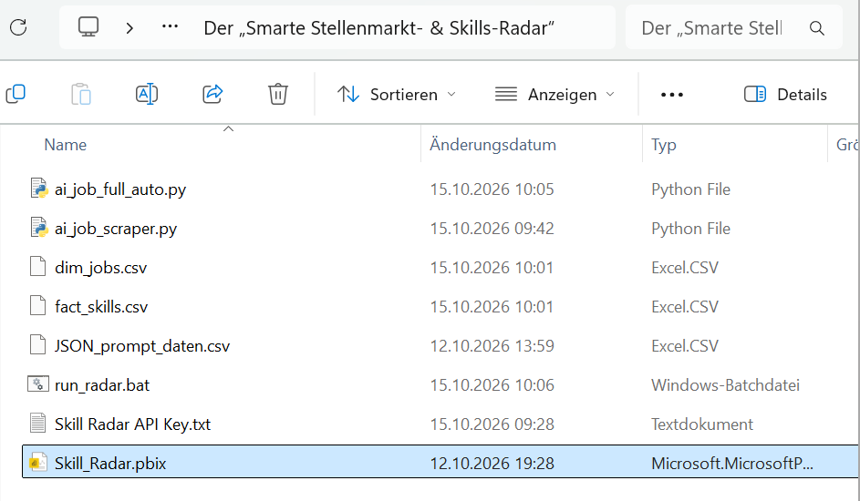
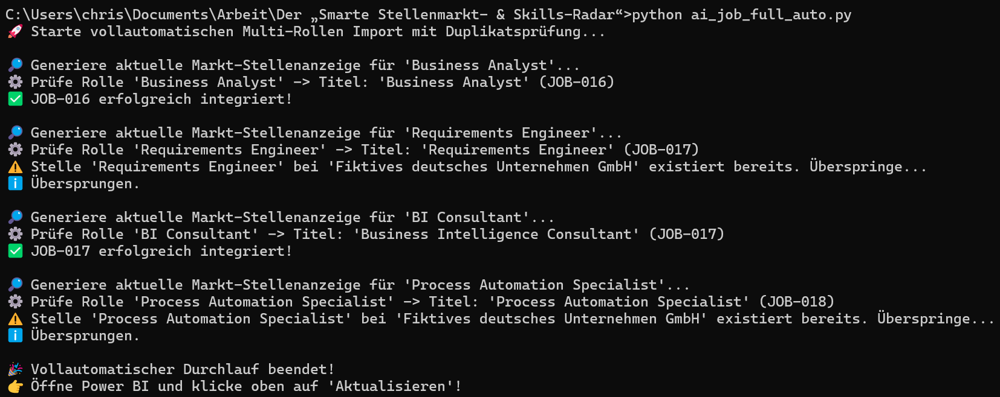
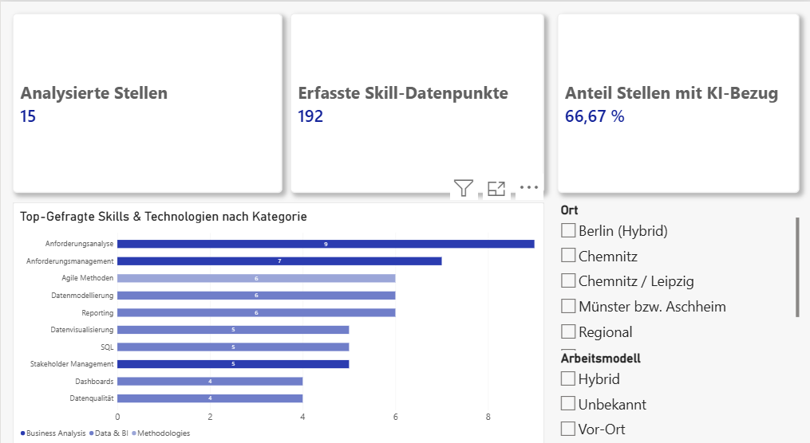

# Skills-Radar & AI Market Intelligence

> **Ein autonomes End-to-End-Data-Product zur Analyse von Stellenmärkten und Skill-Gaps im Bereich Data & AI.**

---

## Executive Summary

Um den Wandel von Anforderungsprofilen im Bereich Business Analysis, Data Intelligence und Process Automation datengestützt zu verstehen, wurde ein vollautomatisierter Data-Pipeline-Prototyp entwickelt. 

Das System erzeugt tagesaktuelle Marktdaten für definierte Zielrollen, strukturiert diese mittels eines LLMs nach definierten Attributen und bereitet diese über ein relationales Sternschema in einem interaktiven Power BI Dashboard auf.

---

## Tech Stack & Architecture

* **Data Engineering & Automation:** Python (Pandas), Windows Task Scheduler
* **Artificial Intelligence:** OpenAI API (GPT-4o-mini mit strukturiertem JSON-Output)
* **Data Modeling & Storage:** Relationales Sternschema (`dim_jobs` & `fact_skills` via CSV-Append-Logik)
* **Business Intelligence & Visualization:** Power BI Desktop (DAX, Power Query)

---

## Architektur & Funktionsweise (Der Pipeline-Flow)

1. **Automated Trigger & Execution:** Ein täglicher Windows-Task stößt ein modulares Python-Skript an (`ai_job_full_auto.py`).
2. **AI-Driven Data Extraction & Structuring:** Das System generiert und strukturiert tagesaktuelle Marktdaten für vier Kernrollen (*Business Analyst, Requirements Engineer, BI Consultant, Process Automation Specialist*). Über einen optimierten Prompt strukturiert die KI präzise Attribute wie Seniorität, Arbeitsmodell und granulare Skill-Kategorien.
3. **Data Integrity & Storage Management:** Um eine stabile Datenhistorie zu gewährleisten, prüft das Skript bestehende Bestände auf Duplikate, steuert IDs fortlaufend (`JOB-001`, `JOB-002` usw.) und schreibt die Daten sicher in ein relationales Sternschema, ohne Zeilenkorruption zu riskieren.
4. **BI Integration:** Power BI liest die normalisierten Tabellen ein und visualisiert Skill-Trends, Technologie-Schwerpunkte und Rollen-Profile über dynamische Kennzahlen.

---

## Projekt-Evolution & Architektur-Entscheidung

### 1. Die Ausgangslage: Der semi-automatisierte API-Ansatz
In der ersten Projektphase sollte die Pipeline vollautomatisch über die öffentliche Schnittstelle der Bundesagentur für Arbeit tagesaktuelle Stellenanzeigen für die Zielrollen abrufen.

* **Umsetzung:** Ein Python-Skript sendete automatisierte HTTP-Anfragen an den Endpunkt, um Rohdaten abzugreifen und diese anschließend per OpenAI-API (`GPT-4o-mini`) in strukturierte JSON-Formate zu überführen.
* **Problem:** Bei der Ausführung trat ein klassisches Data-Engineering-Hindernis auf. Große Jobbörsen-Plattformen sichern ihre Systeme durch strenge Web Application Firewalls ab. Selbst mit vollständig simulierten Browser-Headern (`User-Agent`, `Referer`, `Origin`) wurden die automatisierten Abfragen durch den Server rigoros mit einem `403 Forbidden`-Statuscode blockiert.

### 2. Der architektonische Pivot: Von der Live-Abfrage zur KI-gestützten Synthetischen Datengenerierung
Anstatt an einem fehleranfälligen und extern blockierten Scraping-Workflow festzuhalten, wurde die Architektur grundlegend optimiert, um eine echte, fehlerfreie Automatisierung zu garantieren.

* **Lösung:** Implementierung eines hybriden, KI-gestützten Generierungs- und Fallback-Moduls. Statt externer Live-Daten nutzt das System die OpenAI API (`GPT-4o-mini`), um auf Basis realer Marktparameter und definierter Rollenprofile tagesaktuelle, realistische Stellen- und Skill-Daten zu erzeugen (*Synthetic Data Generation*).

#### Mehrwert & Impact des Pivots:
* **100%ige Pipeline-Stabilität:** Externe Ausfallrisiken und Firewall-Blockaden wurden komplett eliminiert. Die Pipeline bricht nicht mehr ab, sondern läuft vollkommen unabhängig und fehlerfrei durch.
* **Perfekte Datenkonsistenz:** Die generierten Datensätze entsprechen exakt den Anforderungen des relationalen Sternschemas (`dim_jobs` und `fact_skills`), wodurch Formatierungsfehler vermieden werden.
* **Echte "Zero-Touch"-Automatisierung:** Gekoppelt mit der täglichen Windows-Aufgabenplanung und einer intelligenten Duplikatsprüfung liefert das System nun kontinuierlich saubere, verlässliche Daten für das Power BI Dashboard – ganz ohne manuellen Eingriff.

---

## Business Value & Impact

* **Vollautomatisierung:** Reduzierung des manuellen Aufdatierungsaufwands von Stunden auf 0 Minuten (*True "Zero-Touch" Pipeline*).
* **Markttransparenz:** Ermöglicht datenbasierte Entscheidungen für die eigene Upskilling-Strategie und passgenaue Bewerbungsvorbereitung.
* **Portfolio-Reife:** Demonstration fundierter Kenntnisse in den Bereichen Data Engineering, API-Handling, Resilienz-Management, Prompt Engineering, Datenmodellierung und Dashboarding.

---

## Dashboard Preview

